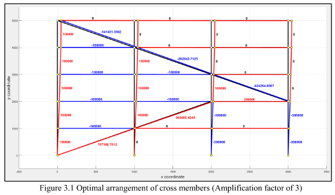
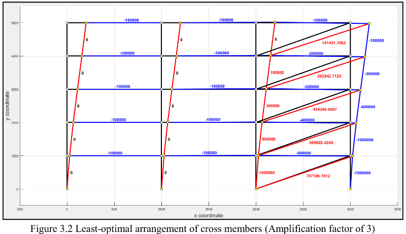

# Modelling of a Sway Structure

Coursework for CI2-221 Computational Methods II, 2nd year Civil Engineering at Imperial College London (2017). The task was to find the most efficient steel structure that resists lateral load. It is solved with a general truss and frame stiffness-method solver written in object-oriented MATLAB.

📄 [Report](docs/report.pdf)

## Problem

The structure has 3 bays and 5 storeys, 1 m apart, with a 100 kN horizontal load at each storey. Each storey gets one diagonal cross member in one of 6 positions. The task is to find:

1. The arrangement of cross members that minimises lateral sway
2. How a pin-jointed truss compares with a rigid-jointed frame (no cross members)
3. The smallest member radius that keeps sway at 25 mm, and the volume of steel it needs
4. Which members would buckle, and how to make the structure safe while using less steel

## Approach

- `TRUSS` and `FRAME` classes solve any 2D truss (2 degrees of freedom per node) or Euler-Bernoulli frame (3 degrees of freedom per node). They assemble the global stiffness matrix, solve for displacements and reactions, check equilibrium, and compute axial loads and Euler buckling margins.
- An exhaustive search covers all 6⁵ = 7,776 arrangements of cross members, enumerated as base-6 numbers.
- `fzero` finds the member radius that gives exactly 25 mm of sway (`TrussSway`, `FrameSway`). The final step enlarges members at risk of buckling and shrinks the others (`TrussOptimisation`).

## Results

These figures show the optimal (top) and least-optimal (bottom) arrangements, with axial loads labelled: compression in blue, tension in red. The optimal truss transfers load to the ground along the shortest continuous path.

| Structure | Sway at r = 25 mm | Min. radius for 25 mm sway | Steel volume |
|---|---|---|---|
| Optimal truss | 15.9 mm | 19.94 mm | 0.0525 m³ |
| Least-optimal truss | 67.3 mm | 41.03 mm | 0.2225 m³ |
| Frame | 1082 mm | 64.63 mm | 0.4594 m³ |

The optimal truss uses the least steel, but its slender compression members buckle (margin of safety −0.71). Enlarging those members and shrinking the rest gives a buckling-safe truss with 25 mm of sway and only **0.0481 m³** of steel.

## Code

| File | Purpose |
|---|---|
| [`src/Coursework.m`](src/Coursework.m) | Main script: builds the geometry for any number of bays and storeys, then answers each question in turn |
| [`src/TRUSS.m`](src/TRUSS.m), [`src/FRAME.m`](src/FRAME.m) | Solver classes: `Solve`, `EquilibriumCheck`, `AxialLoad`, `BucklingCheck`, `Plot` and more |
| [`src/TrussSway.m`](src/TrussSway.m), [`src/FrameSway.m`](src/FrameSway.m), [`src/TrussOptimisation.m`](src/TrussOptimisation.m) | Objective functions for `fzero` (sway − 25 mm) |

To run it, open MATLAB in `src/` and run `Coursework`. All units are N and mm.

## Acknowledgements

Taught by Dr. Adam Jan Sadowski.
